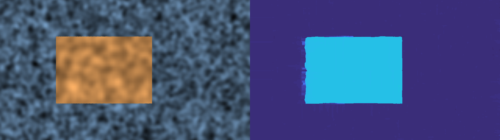

# vr180-depth

**Status:** exploration · v0.1 · no live URL

Turn VR180 or side-by-side 3D video into per-frame depth maps for compositing. Made for the Calf Gen 1 VR180 camera; works with any parallel stereo rig.



## TL;DR

```bash
uv venv && uv pip install -e .
vr180-depth demo                      # synthetic clip with known depth, no camera needed
vr180-depth run clip.mp4 -o out --every 5 --max-frames 20
```

For every frame you get a flat image of the left eye and a depth map that lines up with it pixel for pixel.

## What comes out

| Path | Contents | Use it for |
|---|---|---|
| `view/` | 8-bit flat view of the left eye | the plate; depth lines up with this image |
| `depth_mm/` | 16-bit PNG, depth in millimetres, 0 = unknown | real distances, Blender, measuring |
| `matte/` | 16-bit PNG, white at `--near`, black at `--far` | fog, focus and relight mattes in Resolve, Nuke, After Effects |
| `preview.mp4` | view and colour depth side by side | a quick check |
| `meta.json` | view size, focal length, all settings | reproducing or converting a run |

The matte ramp is linear in 1/depth, so most grey levels land in the near range where stereo is accurate.

## How it works

1. Split each frame into left and right eye.
2. Cut a flat view out of both VR180 eyes with the same virtual lens. Two parallel cameras seen through one lens model form a rectified pair: a point sits on the same row in both images.
3. Measure the vertical offset between the eyes from feature matches and cancel it. Real lenses are never perfectly level, and row matching fails on even a 2 px offset.
4. Match the eyes with OpenCV SGBM. The horizontal shift (disparity) becomes distance: `depth = focal_px × baseline / disparity`.
5. Optional `--ai`: Depth Anything V2 gives sharp, dense depth without real scale. Each frame it is fitted to the stereo result with one scale and one offset, so the output keeps the AI's detail and the stereo's metres. Where valid stereo disagrees with the fitted AI by more than 20% (`--ai-tolerance`), stereo wins: a still-image model can miss depth that has no visual cue, and stereo measures it directly.

## AI refinement

```bash
uv pip install -e ".[ai]"
vr180-depth run clip.mp4 -o out --ai
```

The first run downloads Depth Anything V2 Small (about 100 MB). It runs on Apple GPUs (MPS) or CUDA when available, otherwise CPU. The Small checkpoint is Apache 2.0; the Base and Large checkpoints are non-commercial, so check before using `--ai-model` with them.

## Calf Gen 1 notes

- The camera stitches in-camera to side-by-side VR180, which matches the defaults (`--layout sbs --projection equirect`).
- I could not find a published lens baseline. `--baseline 0.065` is a guess. To calibrate, film an object at a measured distance, run, and set `baseline = 0.065 × true distance / measured distance`.
- Vertical coverage is about 160 degrees, so keep `--pitch` within roughly ±30.
- With a ~65 mm baseline, depth is good within a few metres and coarse past about 10 m.

## Other stereo sources

- Flat side-by-side 3D that is already rectified: `--projection flat --fov <horizontal degrees>`
- Top-bottom layout: `--layout tb`
- Right eye stored first: `--swap-eyes`

## Limits

- One forward view per run. Turning the view sideways (yaw) breaks rectification, so only `--pitch` is offered.
- Depth Anything V2 is a still-image model. The per-frame fit is smoothed, but expect some flicker on video.
- `--ai` has been run on the synthetic demo only, which has no visual depth cues, so the stereo guard did most of the work there. It still needs testing on real Calf footage.
- Plain stereo gives soft edges and fills occlusion holes from the background.

## Roadmap

- Video Depth Anything for steadier AI depth across frames
- A learned stereo matcher as an option
- EXR output
- Built-in baseline calibration from a known distance

## Development

```bash
uv pip install -e ".[dev]"
pytest
```

Tests use a ray-traced synthetic VR180 scene with known depth (a card at 1.5 m in front of a wall at 4 m).

## License

MIT
